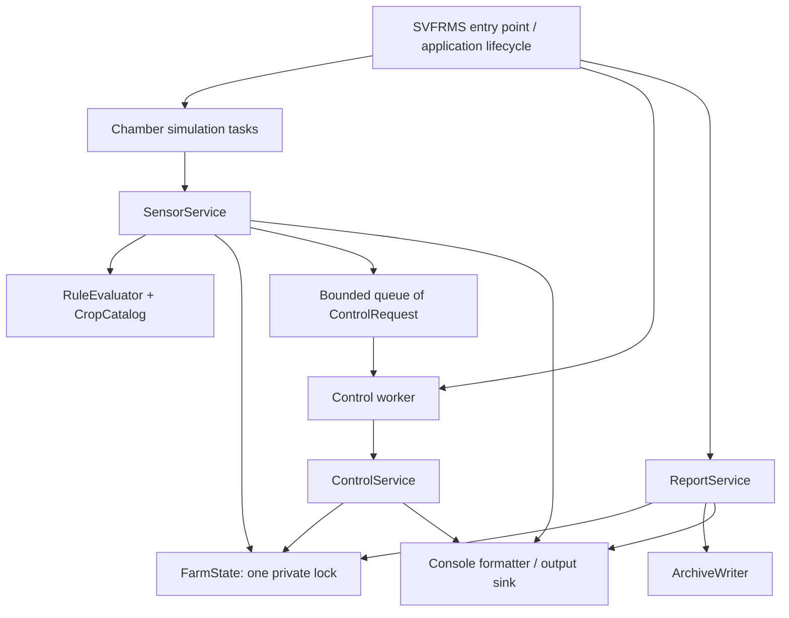

# SVFRMS refactoring plan

## Scope and evidence

This is an inspection and implementation plan, not an application change. Sources inspected:

- [Project specification](se301_project_specification.md), especially sections 3–6.
- [Legacy implementation](../src/main/java/org/example/SVFRMS.java), all 393 lines; method names and line references below refer to this version.
- [Build configuration](../pom.xml) and [run instructions](../README.md).

The original findings are based on static source inspection; no runtime stress tests have been performed. The Markdown specification is used as the requirements source. The bundled PDF and binary ZIP were not independently compared with it or the source. There were no test sources at initial inspection. Stage 1 added characterization tests; [Stage 1 validation](stage-1-validation.md) records the baseline. Stage 2 replaced delimiter-encoded control requests with typed commands; [Stage 2 validation](stage-2-validation.md) records the fix, API migration, tests, and remaining limitations. The legacy analysis below describes the original implementation; the component architecture remains the target design.

Stage 3 has now introduced instance-owned `FarmState`, coherent updates and snapshots, and coordinated concurrency tests. See [Stage 3 validation](stage-3-validation.md) for the current architecture, 139 passing tests, CLI smoke test, and unresolved lifecycle limitations. Source line references below refer to the original legacy version, not the extracted files.

Stage 4 introduced bounded blocking coordination, supervised tasks, cancellation, and single-run admission. [Stage 4 validation](stage-4-validation.md) records its 157 passing tests and CLI validation. Stage 5 extracted immutable crop/rule/assignment data and pure evaluation; [Stage 5 validation](stage-5-validation.md) records 238 passing tests and current limitations. Earlier stage reports describe their historical state; Stage 5 is the latest implementation status.

The specification requires Java 25+, a multi-file Maven application, preservation of existing functionality, corrected concurrency, and easy crop addition/removal. Refactor incrementally rather than replace the simulation. Requirements described in section 3 but absent from the code must be recorded as gaps, not silently introduced as part of extraction.

## Behavior to preserve

### Simulation and lifecycle

`main` (349) launches one control consumer and four chamber producers: CH1/Tomato, CH2/Strawberry, CH3/Lettuce, CH4/Chili. Each chamber performs 20 iterations, processing Temperature, Humidity, Soil, Light, and Nutrient in that order. There is no sampling delay. Integer sample ranges are respectively 10–39, 40–99, 20–79, 300–1199, and 20–99. Each iteration adds 2 L water and 1 kWh energy, independently of triggered devices.

Preserve 400 processed readings and a base usage of 160 L and 80 kWh per normal run. Additional usage depends on readings. These are intended arithmetic totals; lost updates in the legacy concurrent execution are defects, not expected outputs. Random values, timestamps, cross-chamber ordering, and the interleaving of controls with readings are nondeterministic.

Initial chamber state is temperature 24, humidity 70, soil moisture 60, light 600, nutrient 70. Each recognized reading replaces the corresponding state value before evaluating rules. A queued control later changes the state present when it executes, which may already include a newer reading. Do not silently switch to applying controls to the original reading.

Producers finish before shutdown is requested; the control consumer drains queued work before exiting. Reporting and alert archiving then run concurrently and are joined before the final archive file is saved. Preserve these lifecycle guarantees, while making failure and cancellation explicit.

### Exact rule inventory

All comparisons are strict: equality at a threshold produces no alert for that boundary. Every violating reading creates a fresh alert; there is no deduplication, acknowledgement, or automatic resolution. Every alert increments generated and active totals and the chamber alert summary.

| Reading/crop | Trigger | Alert suffix | Queued control | Additional usage at detection |
| --- | --- | --- | --- | --- |
| Temperature/Tomato | >28 / <22 | High Temp / Low Temp | Cooling Fan / none | 10 / 15 kWh |
| Temperature/Strawberry | >24 / <18 | High Temp / Low Temp | Cooling Fan / none | 10 / 15 kWh |
| Temperature/Lettuce | >21 / <15 | High Temp / Low Temp | Cooling Fan / none | none |
| Temperature/Spinach | >20 / <10 | High Temp / Low Temp | Cooling Fan / none | none |
| Temperature/Chili | >32 / <24 | High Temp / Low Temp | Cooling Fan / none | none |
| Temperature/Cucumber | >27 / <18 | High Temp / Low Temp | Cooling Fan / none | none |
| Humidity/Tomato | >80 / <60 | High Humidity / Low Humidity | Dehumidifier / Humidifier | none / 20 L |
| Humidity/Strawberry | >85 / <70 | High Humidity / Low Humidity | Dehumidifier / Humidifier | none / 25 L |
| Soil/Tomato | <45 | Low Soil Moisture | Water Pump | 50 L |
| Light/any crop | <500 | Low Light Level | Grow Light | none |
| Nutrient/any crop | <40 | Low Nutrient Level | Nutrient Injector | none |

Temperature, humidity, and soil alert text includes chamber and crop; light and nutrient text includes chamber but omits crop. Console alert prefixes still include both. Other crop/sensor combinations update the state but have no crop-specific rule. Light and nutrient rules also run for unknown crop strings. Unknown sensor strings are logged but otherwise ignored; unknown control and event strings have no effect. Null strings may throw exceptions. Characterize these edge cases before deciding whether explicit validation should replace them.

Usage is charged when an alert is detected, not when its control executes. Low temperature consumes energy for Tomato/Strawberry without a heating action. Do not normalize these inconsistencies during extraction.

### Control effects

`activateControl` (90) implements the following transformations. Each recognized execution increments mitigation actions once, records the activated device as the last action, and prints activation and resulting-value messages in green ANSI formatting.

| Device | Transformation |
| --- | --- |
| Cooling Fan | temperature = max(18, temperature − 5) |
| Water Pump | soil = min(100, soil + 20) |
| Nutrient Injector | nutrient = min(100, nutrient + 15) |
| Humidifier | humidity = min(100, humidity + 10) |
| Dehumidifier | humidity = max(30, humidity − 10) |
| Grow Light | light = min(1000, light + 150) |

These are literal clamps, not general physical validation: for example, a fan can raise a temperature below 18 to 18. Preserve the formulas initially. The queue is bounded to five pending requests and FIFO by enqueue order; device execution occurs outside its monitor.

### Alerts, reports, and callable helpers

- `handleEvent` (62) separately supports sensor logging, alert-only console logging, control logging, alert creation, alert-summary tracking, and action-summary tracking. Sensor log entries contain a date and processing message, but no chamber identifier.
- `archiveAlerts` (220) moves active alerts to the in-memory archive, clears active alerts, resets the active count, and appends either `Archived N alerts` or `No alerts to archive` to report history. Generated totals and chamber summaries remain cumulative.
- `generateDailyReport` (207) prints generated/active alerts and usage with L/kWh units, and appends `Daily Report` to history. The console report may show active alerts before or after archiving: starting the archive thread first does not guarantee it wins the lock. Preserve the accepted set of outcomes; deterministic ordering would be a separate behavior decision.
- `saveArchiveReport` (309) creates `archive/`, writes UTF-8 `archive/daily_report.txt`, and truncates an existing file. It includes timestamp, totals, archived count, report history, lexicographically sorted chamber summaries, and archived alert messages. Successful normal completion saves after archiving, so active alerts are zero. Save errors print `Could not save archive report: ...` rather than propagate.
- Preserve `showAlerts` and `showLogs`, plus `irrigationCycle` (+100 L) and `feedingCycle` (+20 kWh), even though `main` does not call them. Neither cycle currently changes chamber state or uses its namesake lock.
- Keep the executable CLI entry point and documented Maven/JAR workflow. Public mutable fields are implementation leakage, not a desirable compatibility API; migrate any repository callers before removing them.

## Design flaws and specification gaps

| Finding and evidence | Impact and direction |
| --- | --- |
| One static class owns domain rules, state, queues, workers, console formatting, files, and startup (6–393). | SRP violation; changes have broad impact and isolated testing requires global resets. Extract cohesive components with instance-owned state. |
| Crop names and thresholds are repeated throughout `processSensor` (141–205); chamber assignments are hardcoded in `main`. | OCP violation: adding/removing a crop requires editing branching code. Store crop rules and assignments as data. |
| Strings encode sensors, devices, event types, and `chamber|control` requests. | Misspellings silently disable behavior; delimiter-containing chamber IDs break parsing. Use enums and records internally with compatibility formatting at boundaries. |
| `TRACK_ALERT` and `CREATE_ALERT` are separate calls; active count duplicates list size. | Partial updates and drift are possible. Record an alert and its summary in one transaction; derive the active count. |
| All state and synchronization objects are public static and replaceable (10–29). | Callers can bypass invariants, replace locks, or mix successive runs. Encapsulate behind a single owner. |
| Direct `Random`, `Date`, `System.out`, filesystem, and `Thread` dependencies. | DIP issue at external boundaries; difficult deterministic tests and failure simulation. Inject clock, sample source, output sink, and archive writer where useful. |
| Broad caught exceptions in waits; unstructured worker failures; file failures only printed. | Failures can strand work or still appear successful. Define explicit lifecycle and error policy without changing successful output. |
| Histories grow without retention; each run overwrites one file. | Acceptable for the finite demo, unsuitable for continuous operation. Preserve defaults; defer retention and durable history. |
| No domain inheritance hierarchy or broad application interface exists. | There is no evidenced LSP or ISP violation to claim. Avoid inventing a crop superclass tree or an all-purpose service interface. Prefer composition and small boundary contracts. |

Specification/implementation differences requiring explicit follow-up:

- There is no crop-profile CRUD or profile persistence. Six crops have temperature rules, but only four are simulated by default. Profile addition/removal is a required extension point; a new UI/database is not necessary.
- The specification gives Strawberry/Lettuce soil ranges and Lettuce humidity ranges that are not enforced. Crop-specific light ranges and most maximum soil thresholds are also absent. Do not activate these extra rules merely by creating profile objects.
- Heating Unit, Ventilation System, and Shade Controller are specified but absent. Humidifier and Dehumidifier exist in code and must remain.
- Severity levels and sensor-failure alerts are absent. No finite-number, range, or sensor-timeout validation exists; NaN comparisons can silently avoid alerts. Their addition changes behavior and requires defined policy.
- Weekly crop, water, energy, and nutrient consumption reports are not separate implemented features. Only the daily summary exists; nutrient consumption is not tracked.
- Deliverables mention both `README.pdf` and `report.pdf`. Resolve naming before submission. The current JAR plugin supplies an entry point but does not bundle future runtime dependencies; package an executable `run.jar` with dependencies if introduced.

## Concurrency findings

| Defect or risk | Evidence and reachable consequence | Proposed fix |
| --- | --- | --- |
| Lost counter increments | Four producers update usage and alert counters using read-modify-write operations. Two increments can read the same value and overwrite each other. | Update related counters under the same state lock; individual atomics alone do not ensure consistent multi-field snapshots. |
| Concurrent `ArrayList` mutation | Producers append to `alerts` and `sensorLogs` without synchronization. Entries may be lost and internal state may become inconsistent. | Keep lists private and guarded; return immutable copies. |
| Unsafe map initialization/publication | `getChamberState` and `getChamberSummary` (48, 55) perform unsynchronized check-then-put on shared `HashMap`s. A producer and consumer can create competing objects for one chamber; even distinct-key writes are unsafe. | Initialize/access maps through the state owner. A concurrent map alone would not protect mutable values. |
| Sensor/control state races | Producers replace fields while the consumer reads/modifies those fields in `activateControl`. There is no shared lock or visibility protocol. Summary initialization also races. | Serialize each reading update and each control transformation through the state lock. Preserve the possibility of a later reading occurring before an earlier queued control. |
| Incomplete locking contract | Reporting/archive methods take locks, but alert creators, counters, logs, and state updates do not. Concurrent helper calls could lose newly created alerts during copy/clear or read inconsistent totals. `showAlerts`/`showLogs` can fail during iteration. | One lock for updates, archive movement, and snapshots; format/output copies outside it. |
| Cancellation ignored | Queue waits catch and ignore all exceptions, including interruption (135, 258). Producers cannot cancel reliably. | Use interruptible blocking operations and propagate cancellation or restore interrupt status at the owning boundary. |
| Queue and lifecycle failure hang | If the consumer fails, producers can fill the queue and wait forever; `main` then waits forever joining producers. Submission after shutdown may leave work without a consumer. The mutable capacity and equality-only full check are fragile. | Fixed-capacity blocking queue, supervised workers, admission closed before termination, and failure-triggered cancellation of blocked peers. |
| Repeated invocation retains state | Static collections/counters persist and `controlThreadRunning` remains false after the first run. | Fresh application instances and lifecycle state per run; reject invalid restart on the same instance. |

### Deadlock assessment and existing guarantees

There is **no demonstrated circular lock-order deadlock in this revision**. Both `generateDailyReport` and `archiveAlerts` acquire `alertLock` then `reportLock`. `waterPumpLock` and `nutrientLock` are unused. Do not report a hypothetical reverse acquisition as an existing defect.

The queue uses `while` around waits and `notifyAll` for producer/consumer coordination. Waiting releases the queue monitor, and controls run after releasing it; the normal path does not hold a resource lock while waiting for queue capacity. The shutdown flag is volatile and additionally accessed under the queue monitor. These parts are sound in the normal lifecycle.

`main` joins producers and the consumer before starting report/archive workers, and joins those before saving. These joins provide visibility and prevent live-producer/archive races in the default execution. They cannot recover already lost updates or damaged collections. Races involving concurrent public report/display helpers are API risks, distinct from the default-path races.

A consumer-failure hang is a liveness defect, not evidence of circular monitor deadlock. The refactoring must also avoid introducing one: never perform blocking queue insertion, worker joins, file I/O, or output callbacks while holding the state lock.

## Proposed component architecture

Use plain Java, constructor wiring, and a small number of cohesive classes in separate files. No framework, database, asynchronous event bus, or class per crop is needed.

| Component | Responsibility |
| --- | --- |
| Domain records/enums | `SensorReading`, `SensorType`, `DeviceType`, `ControlRequest`, `Alert`, immutable snapshots, and crop/rule definitions. Keep rendering separate from structured values. |
| `CropCatalog` | Immutable per-run profile lookup and chamber assignments. Separate descriptive ranges from enabled legacy rules so absent rules stay inactive. Global light/nutrient rules remain explicit. |
| `RuleEvaluator` | Pure evaluation producing alert descriptions, usage deltas, and optional commands. Data holds boundaries, actions, and accounting differences; evaluator has no crop-name branches. |
| `SensorService` | Log a reading, evaluate it, and commit reading/alert/summary/usage changes atomically through `FarmState`; then submit any control outside the lock. |
| `FarmState` | Sole owner of chamber state, summaries, usage, active/archive alerts, logs, and report history. One private lock protects all state transactions and immutable snapshots. This favors correctness over unnecessary fine-grained concurrency for four chambers. |
| `ControlService` | Apply a device transformation and action-summary update atomically; return output data for rendering outside the state lock. Start with one clear switch on the device enum. |
| Simulation tasks and control worker | Generate samples and consume a capacity-five `ArrayBlockingQueue<ControlRequest>`. Tasks implement `Runnable`/`Callable`; lifecycle owns execution rather than tasks inheriting from `Thread`. |
| `ReportService` and `ArchiveWriter` | Obtain coherent report snapshots, archive alerts transactionally, preserve text format, and write the existing path/encoding. File I/O happens after releasing state ownership. |
| Application lifecycle and `SVFRMS` | Construct dependencies, start/supervise workers, drain/shut down, run reporting/archive operations, then save. Keep `org.example.SVFRMS` as the thin manifest entry point. |

A reading transaction commits before queue submission, matching current detection-time accounting. If submission fails, surface an incomplete run and cancel peers; do not quietly claim that mitigation happened or roll back an alert already observed. Exactly-once recovery across process crashes is outside this finite in-memory application's scope.

### Patterns and their justification

- **Command:** A typed `ControlRequest(chamberId, deviceType)` replaces the pipe-delimited string. It preserves FIFO asynchronous control while making requests safe to inspect and test. Separate command subclasses for every device are unnecessary.
- **Strategy:** A small `SensorSource` boundary allows the current random simulator and deterministic scripted readings to be substituted. If genuinely different rule algorithms appear later, extract rule strategies then; simple range rules are data today.
- **Repository/catalog:** `CropCatalog` centralizes profile lookup and registration/removal without scattering crop knowledge. Begin with an in-memory implementation, not a persistence framework.
- **Dependency injection through constructors:** Supply catalog, sample source, clock, output, and writer where needed. This separates domain behavior from infrastructure and supports focused tests without a DI container.

Do not introduce Singleton global state, an Observer bus for synchronous bookkeeping, or a device/crop inheritance hierarchy merely to increase the pattern count. There is no current need for Abstract Factory, Visitor, or distributed messaging.

### Lifecycle and extension rules

On normal completion, wait for all producers, close submission, and await the consumer after all admitted submissions and queued commands drain. Stage 4 uses explicit close state and a 100 ms blocking poll instead of the initially proposed typed stop signal, so closing a full queue needs no extra capacity. On failure/interruption, stop admission, cancel all workers (including blocked producers), and await termination with a bounded diagnostic timeout. Observe failures while workers are running, rather than only after joining producers in a fixed sequence. Do not print normal success or publish a complete report for an incomplete run.

Take a daily snapshot and append its history marker in one transaction. Archive movement and its history entry are another transaction. These operations can retain either legacy order without partial snapshots. Render and persist immutable snapshots outside the lock.

Add Kale, Bell Pepper, Bok Choy, or Eggplant through catalog data and assignments; no evaluator edit should be required. Crop names should remain data, not a closed crop enum. Validate profile ranges and duplicate identifiers. For the initial implementation, freeze the catalog per run: remove an unassigned profile before startup, reject removal of an assigned profile until reassigned, and defer live removal semantics. Actual new-crop thresholds need explicit documented inputs; the specification supplies names, not values.

New sensor types extend typed readings, sampling, and rule data. New devices extend the device transformation boundary. New report formats consume snapshots. Severity, sensor failure, additional devices, and continuous operation remain explicit feature work, not hidden refactoring changes.

## Implementation checklist and acceptance evidence

### 1. Establish the behavior baseline

- [x] Add deterministic characterization tests for the rule table: below, equal to, and above each boundary; unsupported crop/sensor combinations; repeated alerts; exact message shapes; asymmetric usage charges.
- [x] Test all six device formulas, clamps, action counts, and the fact that control uses current state at execution time.
- [x] Characterize archive move/reset behavior, empty archive handling, helpers, report sections, sorted chambers, UTF-8 output, overwrite behavior, and save failure messages using temporary directories.
- [ ] Capture timestamps/randomness through seams; avoid asserting one cross-thread order or reproducing corrupted totals. Test all accepted report/archive orders.
- [x] Record the specification gaps above and keep enhancements separate from preservation work.

### 2. Extract without changing rules

- [x] Stage 2: introduce `ControlRequest` and `DeviceType`, migrate queue callers, remove delimiter parsing, and verify request routing/FIFO behavior while retaining the legacy queue synchronization.
- [ ] Introduce typed domain values and compatibility formatting; preserve the CLI entry point.
- [x] Move the exact rule table and assignments into `CropCatalog`; retain global light/nutrient rules and legacy omissions.
- [x] Stage 5: extract pure `RuleEvaluator` and immutable rule/profile values; apply evaluated effects atomically through `FarmState` and verify both the legacy table and custom catalog assignments.
- [ ] Extract evaluator, sensor/control services, state owner, report service, and writer into separate files using constructor wiring.
- [x] Remove static mutable state after migrating callers; verify that two fresh application instances do not share counters, queues, or histories.
- [ ] Run characterization tests after each extraction, keeping the application runnable throughout.

### 3. Correct concurrency and lifecycle

- [x] Protect all farm-state mutations and snapshots with one private lock. Make sensor alert creation plus summary/accounting coherent; derive active count from the active collection. Queue coordination remains separate, with no nested state/queue lock acquisition.
- [x] Replace the manual queue with capacity-five typed blocking coordination; preserve FIFO and detection-time accounting.
- [x] Implement normal drain and supervised failure cancellation. Do not hold the state lock during queue waits, joins, callbacks, or I/O.
- [x] Use barriers/latches and bounded test deadlines, not sleeps as proof: simultaneous updates must retain exact totals and every log/alert; initialization must yield one state per chamber.
- [x] Verify `generated = active + archived`, summed chamber alerts equals generated alerts, and successfully executed controls equal summed actions for the standard processing path.
- [x] Test full-queue backpressure, empty/full shutdown, rejected late submission, producer interruption, consumer failure, and all worker termination. In a successful run, every accepted command executes once and the queue drains. Explicitly test and diagnose callbacks that ignore cancellation.
- [ ] Exercise reports/archiving during updates and assert coherent snapshots and no lost/duplicated alerts. Include repeated stress runs with timeouts as supporting evidence, not a substitute for the locking argument.

### 4. Demonstrate extensibility

- [ ] Add a documented new-crop profile via data only and show it in a chamber; test registration, duplicate rejection, invalid ranges, and removal/reassignment rules.
- [ ] Confirm all original crops and six devices remain supported, including Spinach/Cucumber and helpers unused by default startup.
- [ ] Keep additional specification features in an explicit backlog with their behavior and acceptance tests defined before implementation.

### 5. Validate and package

- [ ] Run the Maven test/package workflow on Java 25+ and smoke-test the executable JAR in a clean working directory.
- [ ] Verify the default simulation produces 400 logs and the expected deterministic-fixture totals, a drained queue, zero final active alerts, and complete archived/summary counts.
- [ ] Produce `run.jar` with any runtime dependencies included; confirm it requires no IDE or external classpath.
- [ ] Prepare the required 3–6 page technical report plus cover page, component diagram, justified patterns, concurrency evidence, and crop-extension demonstration. Resolve the PDF naming discrepancy and include source in the submission ZIP.

Completion means preserved characterized behavior, documented intentional defect corrections, no application-wide mutable globals, safe terminating workers, and a new crop supported through data without core rule changes.
