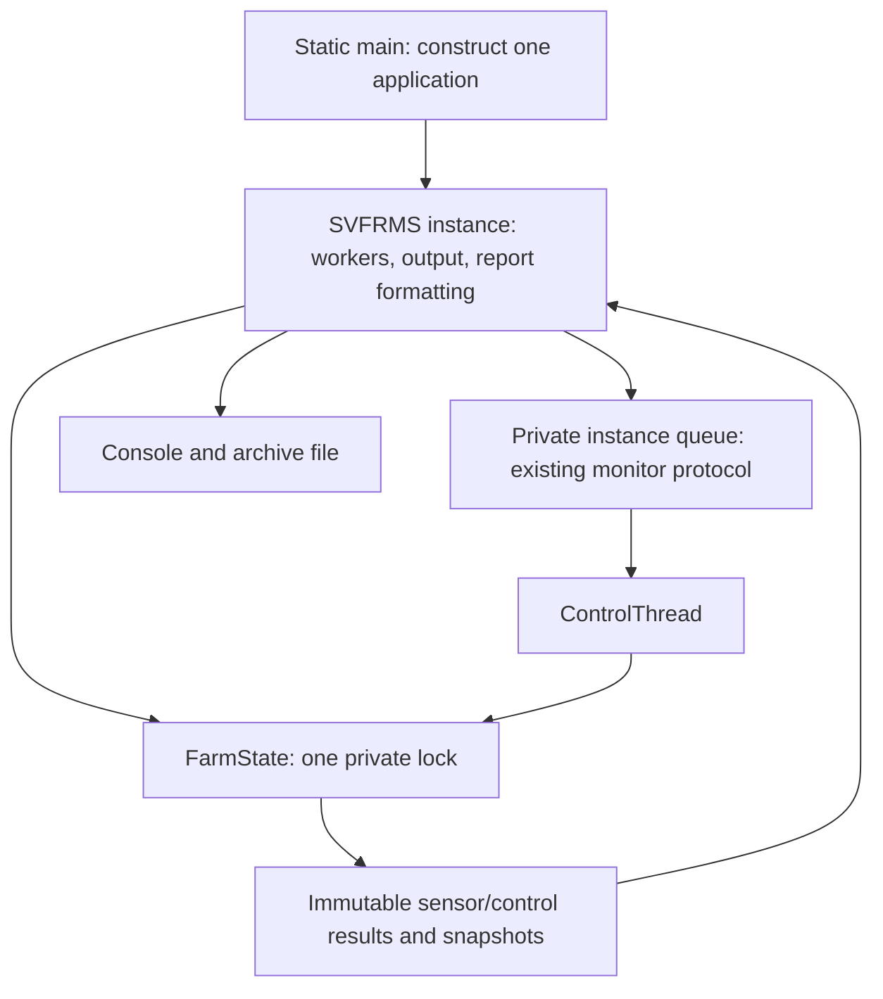

# Stage 3: instance-owned, coherent farm state

Completed on 30 October 2026. This stage fixes shared-state races and establishes immutable snapshots. The queue remains the capacity-five monitor-based queue from Stage 2; supervised shutdown and cancellation are Stage 4 work.

## Original defects and fixes

| Original defect | Stage 3 fix |
| --- | --- |
| Unsynchronized counter increments lose usage and alert totals. | All accounting uses one private state lock. The per-iteration 2 L / 1 kWh update is one operation. |
| Concurrent list writes lose alerts/logs; iteration races with modification. | Lists are private to `FarmState`. Readers receive immutable copies taken under the same lock as writers. |
| Unsynchronized check-then-put can create competing chamber/summary objects or damage maps. | Chamber and summary initialization happens only under the state lock; mutable map values never escape. |
| Sensor updates race with device transformations and action summaries. | A reading transaction includes its log, state replacement, alert/summary updates, and usage charges. A control transaction includes its field transformation, action count, and last-action update. |
| Alert archiving and reporting lock objects that producers do not use. | Archive movement, report history, and snapshots use the same state lock as producers. Active count is derived from the active alert list. |
| Static collections, counters, queue, random source, and shutdown flag survive across applications. | Each `SVFRMS` instance owns a fresh `FarmState`, queue, random source, output sink, and shutdown flag. `main` constructs a new instance. |
| Public mutable state and replaceable lock objects let callers bypass synchronization. | Mutable data and locks are private. Chamber/summary getters, whole-farm snapshots, and queue inspection expose immutable values. Unused resource locks and the separate report/alert locks were removed. |

## Current architecture

[FarmState](../src/main/java/org/example/FarmState.java) owns all chamber data, summaries, usage, alerts, logs, and report history. Its nested records contain primitives, strings, immutable lists/maps, and immutable chamber/summary values. Snapshot creation copies all related data while holding one lock. A daily report appends its history marker and captures its snapshot in the same critical section; archiving moves alerts and records the outcome in another critical section.

[SVFRMS](../src/main/java/org/example/SVFRMS.java) performs output, queue submission, worker joins, and file writes **after** state operations return. `FarmState` has no output callback, filesystem, worker join, or queue dependency. The consumer releases the queue monitor before applying a control. Therefore there is no nested acquisition of the queue monitor and state lock in these paths.

Sensor processing returns immutable alert messages and control requests after committing state. This preserves detection-time accounting even if queue submission subsequently blocks. Control processing returns messages containing the values from its completed transformation, so a later reading cannot change the value rendered for that action.

The original crop branches and device formulas were moved into the state owner without changing their thresholds or accounting. This is an intermediate architecture: a separate rule evaluator/catalog and control service remain later work. No general transaction callback or new design-pattern hierarchy was introduced. A single lock is sufficient for this finite four-chamber simulation and makes whole-farm consistency easier to reason about than independent atomic counters or concurrent maps.

A package-visible constructor accepts the existing `Random` abstraction and a Java `Consumer<String>` output sink. This small constructor seam was introduced now to prove independent application ownership and that blocked output cannot retain the state lock. It also removes global `System.out` replacement from tests. Full simulation/report service extraction and clock injection remain deferred.

## Behavior and API migration

All 125 earlier test cases remain, with the same expected rules, device effects, usage, alert text, report sections, and archive contents. Tests now create fresh instances, inspect snapshots, and seed readings through the application instead of changing fields directly. The report fixture still writes only in a temporary child-JVM working directory.

- Instance methods replace the old static operational API. For example, use `app.processSensor(...)` and `app.snapshot().totalAlerts()` rather than static methods and public fields. `org.example.SVFRMS.main` and the executable JAR entry point remain unchanged.
- Chamber and summary getters return detached records; their fields cannot be mutated, and earlier snapshots do not update when the application changes.
- The queue is private, capacity is a fixed constant of five, `pendingControls()` returns a copy, and `stopControlThread()` signals the existing drain protocol. Direct mutation of queue contents/capacity or lifecycle flags is no longer supported.
- Legacy `CREATE_ALERT`, `TRACK_ALERT`, and `TRACK_ACTION` helper calls retain their separate meanings. Each call is synchronized, but separately invoked helpers are not a combined transaction. Thus the sum-of-chamber-alerts invariant applies to normal sensor processing, not arbitrary unmatched compatibility-helper calls.
- Null chamber identifiers and null created-alert messages are rejected by the state owner; accidental null-containing legacy structures are not a supported compatibility contract. Broader invalid-reading validation remains deferred.
- Report data is coherent regardless of whether its snapshot precedes or follows archiving. Console output happens after unlocking, so cross-thread line interleaving is not a chronological audit of state commits. Both permitted active-alert report values remain covered.

## Concurrency tests

[FarmStateConcurrencyTest](../src/test/java/org/example/FarmStateConcurrencyTest.java) adds 14 executions:

| Coverage | Evidence |
| --- | --- |
| Instance isolation and immutable snapshots | Independent data and queues; all snapshot collections reject mutation; retained chamber/summary values remain unchanged after later operations. |
| Simultaneous first use | Four coordinated workers retain one shared chamber/summary, 1,000 alerts/logs/actions, and 15,000 kWh of low-temperature accounting. |
| Counter consistency | Four workers perform 4,000 usage updates; snapshots preserve the 2:1 water/energy relation and final totals are 8,000/4,000. |
| Control/summary atomicity | Four workers perform 4,000 measurable, unclamped pump transformations while an observer checks each snapshot's soil value against its action count. |
| Concurrent archive and reporting | Two producers, an archiver, and a reporter synchronize at barriers for 50 rounds. Every snapshot reconciles alert totals and usage; final archiving retains all 100 uniquely identified alerts. |
| Blocking output | Six latch-controlled cases block sensor, control, daily-report, archive, alert-display, and log-display output while another worker successfully updates usage and reads state. |
| Queue lock boundary | A producer reaches the full-queue `WAITING` state. Another worker can still read its committed alert/usage; starting the consumer releases the producer and drains all six controls. |
| Four-chamber integration | Four real producer tasks and a real consumer with scripted samples retain 400 logs, 160 L, 80 kWh, 20 Lettuce alerts, and 20 executed controls; the queue drains and final archiving clears active alerts. |

Coordination uses latches/barriers and bounded future/join deadlines rather than arbitrary sleeps. The full-queue test observes the worker's actual waiting state with a bounded deadline. Worker errors propagate through futures, and tests check worker/executor termination. The tests supplement the ownership/locking argument; passing runs alone do not prove all possible schedules safe.

## Validation

| Check | Result |
| --- | --- |
| Baseline immediately after extraction | All 125 existing tests passed. |
| `mvn test` after adding concurrency coverage | 139 tests passed; 0 failures, 0 errors, 0 skipped. |
| `mvn clean package` | Fresh Java 25 compilation of four production and seven test source files; all 139 tests passed; produced `target/svfrms-1.0.0.jar`. |
| Packaged CLI smoke test | Ran with a 15-second deadline in `target/stage3-smoke/`; exit code 0, no stderr, normal completion message, final active alerts 0. This sample generated 135 alerts; archived count and summed chamber alert counts both matched 135. Random totals are not fixed acceptance values. |
| Diff/lock review | `git diff --check` passed. Production has no mutable static fields; output, filesystem operations, queue waits, and joins are outside the state lock. |

The first smoke-test wrapper could not retrieve an exit code from PowerShell's `Start-Process` result. The check was rerun using direct process exit-code capture and passed. This was a verification-script issue, not a reported application failure. No project-root archive was touched.

The Java 25 / Maven 3.9.11 toolchain is unchanged. Maven still prints its non-failing bundled Guice `sun.misc.Unsafe` warning. No new dependency was added.

## Remaining limitations and next stage

- Queue waits still ignore interruption, worker failures are not supervised, late submission is still possible, and a failed consumer can strand producers. Stage 4 will replace and supervise this protocol.
- Fresh applications are isolated, but restarting or concurrently invoking `run()` on the **same** instance is not supported or guarded yet. Lifecycle admission belongs to Stage 4.
- Snapshots cover farm data, not an atomic combination of farm data and pending queue contents. Committed alert/usage data can precede enqueueing or output; this intentionally preserves detection-time accounting.
- Console failures can occur after a state commit. Failed output/submission does not roll back already observed state; failure reporting and cancellation remain Stage 4 work.
- Rule branching, compatibility event strings, timestamp creation, full in-memory history copying, fixed archive location/overwrite behavior, and specification feature gaps remain. Concurrent writers to the same report file are not coordinated; normal startup saves once after worker completion.

Next stage: retain these state boundaries while replacing manual queue waits and supervising normal drain, interruption, late submission, and worker failure.
