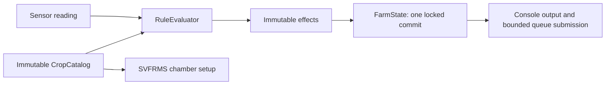

# Stage 5: immutable crop catalog and pure rule evaluation

Completed on 30 October 2026. This stage removes crop-specific branching from state processing and startup. It retains the default behavior characterized in Stages 1–4 and adds no production dependencies.

## Original defects and fixes

| Original design problem | Stage 5 change |
| --- | --- |
| Adding a crop required editing `processSensor` branches and repeating alert/accounting code. | `CropProfile` contains explicitly enabled `ThresholdRule` values; `RuleEvaluator` evaluates any profile without branching on crop names. |
| Crop thresholds, message text, control selection, and usage charges were interwoven with mutable chamber updates. | Rules produce immutable effects describing alert text, an optional control request, and usage deltas. `FarmState` commits those effects with the reading and log in one transaction. |
| Global light/nutrient rules and crop-specific omissions could be lost when normalizing profiles. | `CropCatalog` separates global rules from profile rules. Its default configuration contains exactly 17 crop rules and two global rules. |
| Startup hardcoded four crop names and assumed four producers throughout shutdown. | Ordered chamber assignments come from the catalog; producer counts, executor size, and completion accounting derive from those assignments. Default assignments remain CH1/Tomato, CH2/Strawberry, CH3/Lettuce, CH4/Chili. |
| Mutable configuration would need additional synchronization during evaluation. | Catalog maps/lists and profile rule lists are defensive immutable copies. Configuration is fixed for an application instance. |

## Components and concurrency boundary

- [SensorType](../src/main/java/org/example/SensorType.java) defines the five supported rule keys and maps the exact legacy sensor strings. Unknown strings remain unsupported rather than being normalized or corrected.
- [ThresholdRule](../src/main/java/org/example/ThresholdRule.java) stores sensor, strict `BELOW`/`ABOVE` comparison, threshold, alert suffix, optional device, and water/energy charges. A null device represents an alert-only rule.
- [CropProfile](../src/main/java/org/example/CropProfile.java) stores a crop name and its enabled rules. Crop names remain data, not an enum or inheritance hierarchy.
- [CropCatalog](../src/main/java/org/example/CropCatalog.java) provides profile lookup, global rules, and ordered chamber assignments. `legacyDefaults()` is the single source of built-in crop names and thresholds.
- [RuleEvaluator](../src/main/java/org/example/RuleEvaluator.java) reads only the catalog and incoming reading. It returns an immutable list of effects without state mutation, timestamps, output, or queue access.

`FarmState.processSensor` evaluates before acquiring its private lock, because rules depend only on immutable configuration and the supplied value. Under the lock it appends the log, replaces the recognized reading, and applies all alert, summary, and accounting effects. Output and queue submission still occur after unlocking. There is no callback or mutable configuration access inside the transaction. Device transformations continue to act on state at execution time.

The catalog is a small in-memory lookup component, with constructor injection into `SVFRMS` and `FarmState`. This supports the open/closed principle without a configuration framework, database, general rule engine, or separate strategy class per crop. The evaluator uses one algorithm over data; a Strategy interface is not needed for identical threshold logic. The existing Command representation remains unchanged.

## Preserved behavior and configuration semantics

- All 19 thresholds retain strict comparisons; equality is in range. Every violating reading still creates a new alert.
- Low-temperature alerts for Tomato/Strawberry still charge 15 kWh without requesting heat; high-temperature charges remain limited to those two crops. Humidity/soil water charges retain their legacy differences.
- Profile alerts include the crop name. Global light/nutrient alerts omit it, while console alert prefixes still include it.
- Global light/nutrient rules still apply to unregistered crop strings. Other unknown-crop combinations update recognized readings without crop-specific alerts. Lookup is case-sensitive.
- Missing humidity/soil rules remain missing. Specification example ranges are not interpreted as newly enabled rules. There is no implicit upper soil threshold or crop-specific light threshold.
- Unknown sensor strings are logged without changing readings or creating alerts. NaN readings retain the existing no-threshold-match behavior; no sensor-failure feature was added.
- When custom configuration explicitly supplies both profile and global rules for a sensor, all matches apply in profile-list order followed by global-list order. There is no implicit override or deduplication.

`new SVFRMS()` and existing constructors select `CropCatalog.legacyDefaults()`. `new SVFRMS(catalog)` accepts a caller-built immutable catalog. A package-visible constructor also accepts the existing random/output/report-path test boundaries. The same catalog supplies both rule evaluation and chamber setup.

Configuration construction rejects duplicate crop names, duplicate chamber assignments, unknown assigned crops, blank configured names/suffixes, non-finite thresholds, and negative usage charges. These checks validate configuration, not incoming measurements. Direct sensor calls still support unknown crop strings and empty chamber identifiers as before; stricter assignment-name validation applies only to catalog configuration.

The executor retains one consumer plus one worker per configured chamber, with at least two threads for report/archive processing. Zero assignments close and drain the queue immediately; one or more assignments use the same supervised lifecycle as the default four. This is intended for the finite simulation, not a facility-scale thread-pooling strategy.

## Tests and validation

All 157 earlier cases pass without changing their expected behavior. Two new suites add 81 executions:

| Suite | Executions | Evidence |
| --- | ---: | --- |
| [RuleEvaluatorTest](../src/test/java/org/example/RuleEvaluatorTest.java) | 70 | Reuses the independent legacy table for 57 below/equal/above checks directly against pure evaluation; verifies alert text, optional commands, usage, repeated evaluation, immutable results, unknown sensor names, global fallback, NaN behavior, explicit combined scopes, and concurrent callers sharing an evaluator. |
| [CropCatalogTest](../src/test/java/org/example/CropCatalogTest.java) | 11 | Verifies exact defaults/omissions, deep configuration immutability, invalid configuration rejection, and complete supervised runs with zero, one, and six configured chambers. |

The custom-run tests use a synthetic `Fixture` profile with explicit test-only charges and thresholds. They verify changed configuration affects readings, alerts, device actions, usage, reports, and worker counts without editing the evaluator. They are not proposed agricultural thresholds or the final new-crop demonstration. Default profiles remain unchanged.

| Check | Result |
| --- | --- |
| Baseline after extraction | All 157 existing tests passed. |
| `mvn test` with catalog/evaluator coverage | 238 tests passed; 0 failures, 0 errors, 0 skipped. |
| `mvn clean package` | Ten production and eleven test source files freshly compiled for Java 25; all 238 tests passed; produced `target/svfrms-1.0.0.jar`. |
| Packaged CLI smoke | Ran the default catalog in `target/stage5-smoke/` with a 15-second deadline. Exit code 0, no stderr, normal completion, zero final active alerts. This random sample generated 138 alerts; archived and summed chamber totals both matched 138. |
| Source review | `git diff --check` passed. Built-in crop names appear only in `CropCatalog`; no crop-name branching remains in `FarmState`, `SVFRMS`, or `RuleEvaluator`. |

The toolchain remains Java 25 / Maven 3.9.11. Maven's bundled Guice still emits its non-failing `sun.misc.Unsafe` warning. Tests and smoke validation did not touch a project-root archive.

## Remaining limitations and next stage

- The catalog is Java configuration data, with no file loader, UI, persistence, or live mutation. Dedicated registration/removal/reassignment workflows and the documented new-crop demonstration remain Stage 7 work.
- Profiles model enabled thresholds, not descriptive agricultural ranges. Validation of conflicting/duplicate rule boundaries and removal policies remains part of the extension stage. Explicitly overlapping custom rules currently produce multiple effects.
- Simulation tasks, clock usage, console/report formatting, file writing, and device transformations still need their planned component extraction. Legacy invalid/null-input exception timing is not a compatibility guarantee; a broader validation policy remains deferred.
- Stage 4's limitations still apply: cancellation is cooperative, state commits and enqueueing are separate, and report-save errors retain the legacy printed-error behavior. Specification features absent from the legacy code remain absent.

Next stage: extract simulation and reporting boundaries, inject the clock, and preserve report/sample behavior through deterministic tests.
