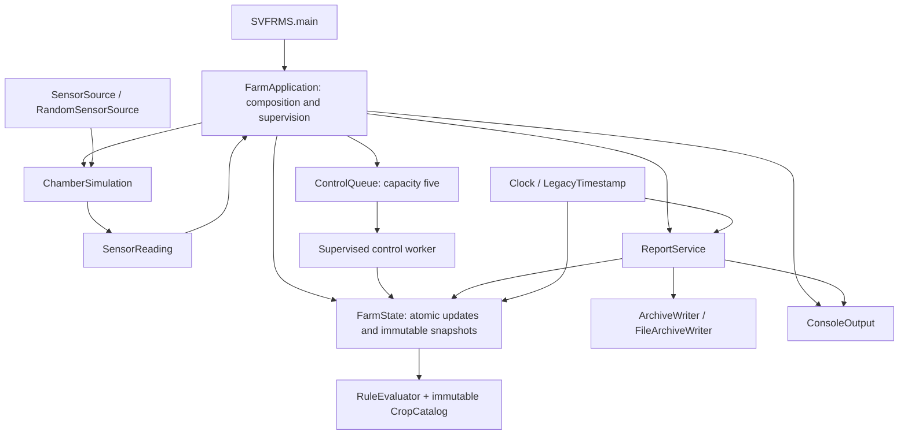

# Stage 6: simulation and reporting boundaries

Completed on 30 October 2026. This stage separates sampling, presentation, and persistence from application supervision and adds deterministic time/sample inputs. No production dependency or framework was added.

## Original defects and fixes

| Original design problem | Stage 6 change |
| --- | --- |
| The entry-point class also generated random samples, supervised workers, formatted output, and wrote files. | `SVFRMS` now only starts `FarmApplication`. Supervision stays together there; simulation and reporting have separate components. |
| Sampling ranges were embedded in the producer loop, making complete scenarios depend on random-number implementation details. | `RandomSensorSource` owns the exact five ranges. `ChamberSimulation` consumes a `SensorSource`, forwarding each typed `SensorReading` before requesting another sample. |
| Direct `new Date()` calls made exact log/report assertions dependent on wall-clock time. | Constructor-injected `Clock` supplies both state logs and report timestamps through `LegacyTimestamp`. |
| Console formatting and report-file formatting were mixed with orchestration. | `ConsoleOutput` preserves prefixes/ANSI codes; `ReportService` formats coherent snapshots and delegates persistence to `ArchiveWriter`. |
| File-system failure tests required actual file-system obstacles, and a replacement writer could accidentally receive live mutable data. | `FileArchiveWriter` handles UTF-8 directory creation and truncation; injected writers receive immutable, detached report lines. |
| Introducing a callback clock inside a state transaction could stall all state access. | Clock reads and formatting happen before acquiring the state lock. Coordinated blocking-clock tests verify unrelated updates and snapshots still complete. |

## Implemented architecture and patterns

- **Strategy:** `SensorSource` is a single-method boundary for random or scripted samples. Five bounds remain in one implementation; no hierarchy per sensor or crop is needed.
- **Constructor injection:** The catalog, source, clock, console sink, report path, and writer are supplied explicitly. Default constructors wire the legacy CLI behavior. The complete application injection constructor is package-visible for tests; the component constructors are directly usable.
- **Persistence boundary:** `ArchiveWriter` accepts already-formatted lines. `FileArchiveWriter` owns file operations, while report snapshot selection, format, and legacy error presentation belong to `ReportService`.
- **Existing Command and catalog patterns:** Typed requests, bounded coordination, immutable profiles, and pure evaluation are unchanged from Stages 2–5.

`FarmApplication.processSensor` and `activateControl` remain short coordination methods: state transactions return output/command data, then console output and queue submission happen outside the state lock. Device transformations stay in the state owner so reading changes and action accounting remain atomic. The original plan's separate `SensorService`/`ControlService` forwarding classes would add no independent behavior at this stage, so these roles are implemented without additional wrappers.

`SVFRMS` remains the manifest entry point and `java -jar target/svfrms-1.0.0.jar` remains the command. Java callers that previously constructed `SVFRMS` now construct `FarmApplication`; all repository callers/tests were migrated. This is a source API migration, not a claim of binary compatibility with earlier stages.

## Preserved behavior and concurrency

- Each chamber still runs 20 iterations in Temperature, Humidity, Soil, Light, Nutrient order. Ranges remain 10–39, 40–99, 20–79, 300–1199, and 20–99. Every complete iteration charges 2 L and 1 kWh; a failed partial iteration does not charge the base usage.
- The default four assignments, all crop thresholds, detection-time charges, duplicate alerts, device transformations, queue capacity, drain, cancellation, and report/archive sequencing remain unchanged. Cancellation is checked before each sample; the interrupt flag is retained.
- Report labels, ordering of sections, sorted chamber summaries, ANSI control messages, UTF-8 encoding, directory creation, and file replacement remain intact. Either legacy report/archive history order is accepted.
- Timestamp layout remains English `EEE MMM dd HH:mm:ss zzz yyyy` in the clock's zone. Defaults capture the system zone at construction. On the validated Java 25 runtime, Singapore renders as `GMT+08:00`, including legacy `Date.toString()`; UTC renders as `UTC`. Initial new tests incorrectly assumed `SGT` and were corrected after comparing both formatters on the installed runtime.
- Logs obtain their timestamp before the state commit. Concurrent log order is commit order, not guaranteed timestamp order. A custom clock cannot hold the farm-state lock while blocked.
- Report formatting, clock access, console callbacks, and writer calls occur outside the state lock. A writer receives immutable lines from one captured snapshot, so subsequent updates cannot change the report being written.
- Output and sampling callbacks shared between workers must be thread-safe. Defaults use `System.out` and `Random`; scripted concurrent test output uses a concurrent collection. No new global lock serializes callbacks.

## Tests and validation

The 238 previous tests passed immediately after extraction, with caller names migrated and expected behavior unchanged. Two new suites add 17 executions:

| Suite | Executions | Evidence |
| --- | ---: | --- |
| [SimulationBoundaryTest](../src/test/java/org/example/SimulationBoundaryTest.java) | 8 | Exact random bounds/endpoints, 100 ordered read/process pairs per chamber, usage after complete iterations, sampling failure propagation, and interruption before another sample. |
| [ReportingBoundaryTest](../src/test/java/org/example/ReportingBoundaryTest.java) | 9 | Exact UTC/Singapore timestamps, legacy default-zone comparison, a complete scripted four-chamber run, writer failure output, immutable report contents during blocked I/O, concurrent state access during blocked clocks, and real UTF-8/truncation behavior. |

The scripted full run fixes all five readings and time, producing 400 logs, 20 Lettuce high-temperature alerts, 20 cooling actions, 160 L water, and 80 kWh energy. It verifies every log, the complete report's sections and repeated archived alerts, zero active alerts, an empty command queue, and terminated workers. It accepts either report/archive history order rather than requiring a scheduler outcome.

| Check | Result |
| --- | --- |
| Extraction baseline | All 238 earlier tests passed. |
| `mvn clean package` after new coverage | 255 tests passed; 0 failures, 0 errors, 0 skipped. Freshly compiled 20 production and 13 test source files for Java 25; produced `target/svfrms-1.0.0.jar`. |
| Packaged CLI smoke | Ran the default CLI in `target/stage6-smoke/` with a 15-second deadline. Exit code 0, empty stderr, normal completion, and zero final active alerts. This random sample generated 138 alerts; archived and summed chamber counts both equaled 138. |
| Source review | Reviewed the extraction against the previous application and checked the working diff for whitespace errors. `SVFRMS` contains only the stable entry point; file operations are confined to `FileArchiveWriter`. |

Java 25.0.4.1 / Maven 3.9.11 were used. Maven's bundled Guice emits the existing non-failing `sun.misc.Unsafe` warning. Tests use temporary paths; the CLI smoke writes under `target`, leaving the project-root archive untouched.

## Unresolved limitations and next stage

- Catalog registration/removal/reassignment workflows, conflicting rule validation, and the documented new-crop demonstration remain Stage 7 work. No live configuration changes or file loader were introduced.
- Cancellation remains cooperative. The Stage 4 bounded cleanup and diagnostic behavior apply to a source/output callback that ignores interruption. A synchronous final writer can also block its caller; no writer timeout or asynchronous persistence was added.
- State commit and command admission remain separate. Failed runs can retain detected alerts whose mitigation was not completed; there is no transactional crash recovery.
- Report-write errors retain the printed legacy error behavior. `COMPLETED` describes successful processing and worker cleanup, not guaranteed durable report storage. File replacement is truncation, not an atomic crash-safe rename.
- The default clock captures a zone per instance; changing the JVM default zone mid-run does not reconfigure it. Timestamp zone names depend on the JDK locale data. Null/invalid direct API input compatibility and specification features absent from the legacy implementation remain outside this stage.
- Final submission packaging, technical-report artifacts, and broader integration review remain later work.

Stage 6 changes are left uncommitted for review. The preceding Stages 1–5 were committed as `43946d5` and pushed to `origin/refactor/svfrms-modernization-gpt-astra` before completing this stage.
