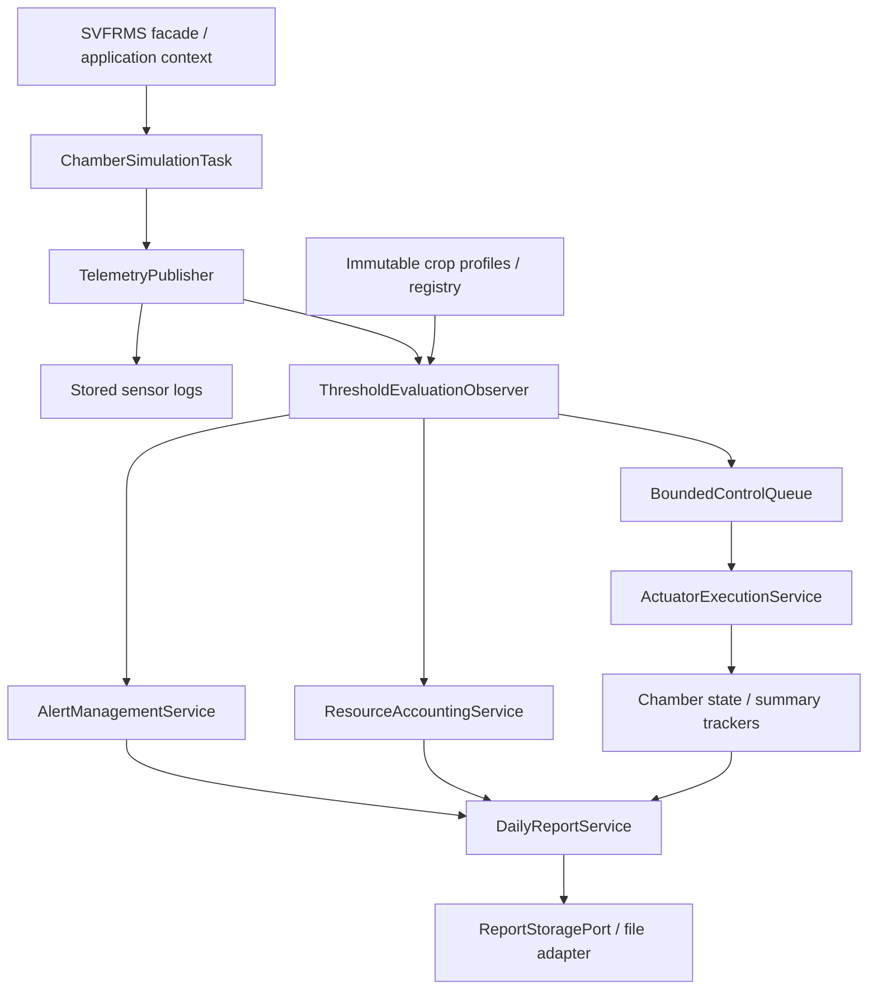

# SVFRMS technical report

Status: automated source/build/smoke verification complete; final report cover requires actual team identities.

## 1. Legacy analysis and preservation boundary

The supplied application simulates five sensor types in four growing chambers, creates alerts for six named crop profiles, queues six device actions, tracks resource totals, and saves a daily archive report. The original is pinned to commit a2ed2ed3266e1f676c0528515b52c1a33f2fabc8. Its 393-line SVFRMS class combines mutable state, evaluation, device actions, presentation, concurrency, and persistence.

Unsynchronized ArrayList writes can lose or corrupt log/alert entries. HashMap check-then-put can create competing state objects. Plain integer increments lose updates. Sensor writers and device actions race on mutable chamber fields. Swallowed interrupts and an uncaught consumer exception can strand producers. Report and archive threads have a phase-order race, although both acquire the same lock order. Worker joins establish visibility before final reporting; they do not undo lost updates that already occurred.

This work preserves implemented behavior. Temperature rules exist for six crops, humidity rules only for Tomato and Strawberry, and soil rules only for Tomato. All crops, including unknown crop names, have lower light/nutrient checks. Equality does not alert. Resource charging is intentionally asymmetric and occurs when an alert is evaluated; a direct control action charges nothing. Sensor logs are stored until explicitly displayed. Missing Section 3 capabilities are specification discrepancies, not new features authorized for this refactor.

| Original evidence | Preserved behavior or repaired defect |
|---|---|
| processSensor, lines 145–203 | Tomato temperature 22–28, Strawberry 18–24, and the other four crop ranges remain strict; no extra humidity/soil rules are enabled |
| processSensor, lines 148–186 | Tomato/Strawberry temperature costs remain 10 high / 15 low energy; low humidity costs 20/25 water; Tomato low soil costs 50 water |
| activateControl, lines 90–129 | Six device deltas and saturation limits remain; direct activation has no resource charge |
| handleEvent, lines 62–87 | Sensor logs stay stored; alert/control formatting and distinct tracking/creation effects remain |
| State/summary initialization | Atomic initialization prevents competing objects; no eager replacement of an existing tracker |
| main, lines 362–391 | Worker joins precede reporting; report/archive order is made explicit instead of scheduling-dependent |
## 2. Final component architecture and SOLID rationale

The component layout separates immutable domain snapshots and profiles, crop evaluation, telemetry, actuator execution, accounting, reporting, and file storage. The composition root supplies dependencies. The facade retains original callable workflows and the executable entry point; state inspection uses immutable snapshots rather than public writable collections.

SRP separates evaluation, accounting, execution and formatting. OCP makes profiles data: adding/removing a test profile does not change the monitoring loop. LSP is addressed through consistent command postconditions and storage exception contracts rather than invented inheritance. ISP keeps commands responsible for state transitions, not unused accounting APIs. DIP places file I/O behind ReportStoragePort and keeps construction in the context. No interface is added merely to label a value object.

## 3. Concurrency and reliability design

Shared concurrent maps atomically initialize one tracker per chamber. AtomicReference transitions replace whole immutable snapshots; retryable functions are pure and cannot emit duplicate logs or charges. Summary count/message pairs update together. LongAdder resource totals are read exactly after writers join; no live globally atomic snapshot is claimed.

The alert service uses one short lock for alert publication, generated count, archival transfer and snapshot capture. The invariant is generated = active + archived. Immutable copies preserve returned values but do not themselves establish atomicity. External output callbacks do not run while holding that lock.

The bounded queue retains capacity five. Admission closes before the stop signal, accepted work is drained before consumer termination, and queue timeout/interruption is surfaced. Command failures are recorded without relying on an error-output callback; subsequent accepted work can finish, but the run cannot claim normal success. Cleanup is idempotent and bounded, producer futures are observed, and the real JVM shutdown hook invokes the same cleanup.

Normal reporting follows producers joined, actuator queue drained/consumer joined, pre-archive console report, archival, completion line, and post-archive file save. This deliberately corrects the legacy phase race. Console/file generated and resource totals agree; console active alerts precede archival and saved active alerts are zero after complete archival. Report history, sorted chambers, ANSI text and error messages retain their legacy formats.

## 4. Patterns, extensibility, and specification traceability

Observer separates required telemetry consumers while preserving ordered synchronous dispatch and visible errors. Strategy isolates threshold evaluation from profile data. Command gives queued work a typed chamber/action identity. The existing profile builder and static factory centralize construction; a static factory alone is not claimed as the GoF Factory Method. The existing reporting template/formatter boundary is retained only for its actual extraction/format/storage responsibilities. No alternate report format, undo framework, or new device hierarchy is added.

Registration atomically replaces one immutable profile. An in-flight reading uses its original profile for threshold and cost decisions; later readings use the replacement. Removal leaves history and accepted controls intact. Later crop-specific checks stop, while original universal light/nutrient fallback remains. Extension tests copy a legacy profile under another name, avoiding invented agricultural presets.

| Specification | Treatment |
|---|---|
| Section 4.1 modular architecture | Multiple focused Maven components; original launcher retained |
| Section 4.2 SOLID | Focused responsibilities, data-driven crops, small contracts, constructor injection and storage port |
| Section 4.3 patterns | Justified against concrete coupling/queue/construction/reporting problems |
| Section 4.4 reliability | Atomic state/accounting, consistent alert snapshots, bounded lifecycle/failure tests |
| Section 4.5 crop changes | Runtime registration/removal verified with test-only copied profiles |
| Section 3 unimplemented descriptions | Heating, ventilation, shading, sensor-failure/severity policy, weekly/additional reports remain absent |
| Sections 5–6 deliverables | Maven source, executable run.jar and 3–6-page report; identical README.pdf/report.pdf names |

## 5. Verification and handoff

Final automated verification passed 185 tests with zero failures, errors or skips, followed by Maven packaging and executable smoke verification. The independent original oracle covers 232 operations and 555 stored sensor logs; the modern execution matches its complete console, log, report and per-step observation outputs. The real shutdown-hook regression also detects temporary removal of the production hook, rather than performing cleanup itself.

The original-source harness compiles the frozen original separately and captures controlled scripts, avoiding a self-referential golden master. Fixtures cover thresholds and boundaries, disabled rules, unknown strings, state, resources, log/report output and control clamps. Only declared timestamps and absolute report paths are normalized. Production time formatting is separately asserted with a fixed clock.

Concurrency tests coordinate using barriers/latches, count exact completed effects, and clean up every worker/process. Failure cases include full queues, failed commands/output callbacks, producer failure, interrupted/concurrent close, late submit and real-hook shutdown. Final verification requires mvn clean test, mvn package, java -jar target/run.jar, inspection of report contents, and clean-directory executable verification. Test counts and final outcomes belong in the remediation evidence document; no throughput claims are made without measurement.

Submission readiness also requires actual group/member details and a human rehearsal of the five-minute presentation/two-minute demo. These cannot be invented or inferred from automated test success.

## References

- Supplied SE301 project specification and original source pinned above.
- Oracle Java SE 25: AtomicReference, LongAdder, ConcurrentLinkedQueue, Random, and JLS 17.4.5 happens-before rules.
- Martin Fowler, Definition of Refactoring: https://martinfowler.com/bliki/DefinitionOfRefactoring.html
- Research documents 01–06, interpreted through their remediation correction notices.